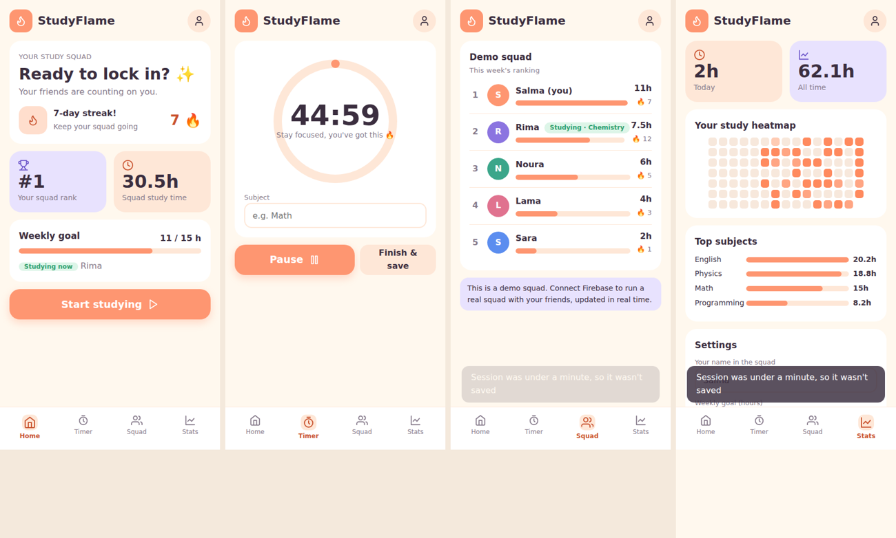

# StudyFlame

A study-together web app. Students track focus sessions with a timer, build daily streaks, and compete in a weekly leaderboard with friends in a shared squad. The leaderboard updates in real time.

**Live demo:** https://YOUR-USERNAME.github.io/studyflame/



## Features

- Focus timer (15 / 25 / 45 / 60 minutes) that keeps correct time even when the tab is in the background
- Sessions saved by day and subject, with a streak counter and a weekly goal
- Study squads: create one or join with a 6-character code, then see a weekly leaderboard
- Live "studying now" indicator for squad members
- Statistics: a heatmap of the last 15 weeks and a breakdown by subject
- Firebase Authentication and Cloud Firestore for accounts, sync across devices, and real-time updates
- Works without Firebase too: data is saved in the browser and a demo squad is shown

## Tech stack

HTML, CSS, and vanilla JavaScript (ES modules). Firebase Authentication and Cloud Firestore through the Firebase JS SDK. No build step.

## Data structure

```
users/{uid}/studyflame/main      progress: name, weekly goal, daily log by subject, squad code
squads/{code}                    squad name and owner
squads/{code}/stats/{uid}        weekly minutes, streak, and studying-now state of each member
```

## Connect your own Firebase project

1. In the Firebase console, add a **Web app** and copy its `firebaseConfig`.
2. Paste it at the top of the script in `index.html`.
3. Enable **Authentication** (Email/Password) and **Firestore Database**.
4. In Authentication > Settings > Authorized domains, add your GitHub Pages domain.
5. Publish these Firestore rules:

```
rules_version = '2';
service cloud.firestore {
  match /databases/{database}/documents {
    match /users/{uid}/{document=**} {
      allow read, write: if request.auth != null && request.auth.uid == uid;
    }
    match /squads/{code} {
      allow read, create: if request.auth != null;
      match /stats/{uid} {
        allow read: if request.auth != null;
        allow write: if request.auth != null && request.auth.uid == uid;
      }
    }
  }
}
```

## Run locally

Open `index.html` in a browser.

## Author

Salma
